# GoShell

**English** | [简体中文](README.zh-Hans.md)

GoShell is a simple terminal GUI client, written in Go via
[MyGo](https://github.com/egoist/mygo). It keeps SSH, Docker and Kubernetes
hosts in one native window, opens terminal sessions under them, and
remembers the hosts in a sidebar.

# Features

- SSH, Docker and Kubernetes hosts. Kubernetes hosts take a kubeconfig and
  context, or a server and token.
- Several sessions per host, listed as children under it in the sidebar.
- A flat list of hosts beside `LOCAL`, with icons and colors telling SSH,
  Docker and Kubernetes apart. Click a host to fold or unfold its sessions;
  the `+` starts new ones.
- A search field in the sidebar that filters hosts and sessions.
- A right sidebar of files for local, SSH, Docker and Kubernetes sessions,
  with a Follow toggle for the shell's current directory.
- Docker container picker with search, images, states and one-click
  connection.
- Kubernetes picker with searchable namespace, pod and container fields, and
  sensible defaults.
- Shortcut commands as chips under the terminal, with a live preview, an
  icon picker and a delete badge on hover.
- Light and dark appearance, following the system by default.
- Ghostty terminal themes.
- English and Simplified Chinese.
- Windows, Linux and macOS, thanks to [MyGo](https://github.com/egoist/mygo).
- Saved passwords, key passphrases and tokens encrypted on disk.
- Finds a local Docker daemon and adds a config for it on first launch.
- Program status (OSC 7501): session row icons show what long-running
  programs are doing; hover for the message.
- Find in the title bar, and a download reminder in it when an update is
  available.
- Signed automatic updates from GitHub releases, with Help > Check for
  Updates…

# Screenshots

### Main
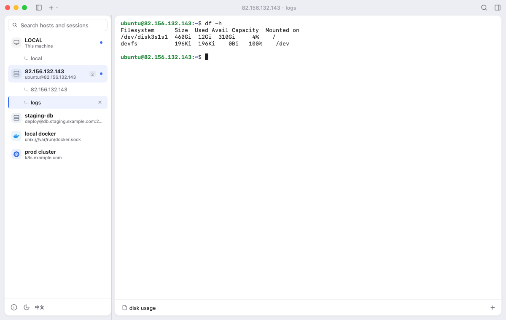

### Dark appearance
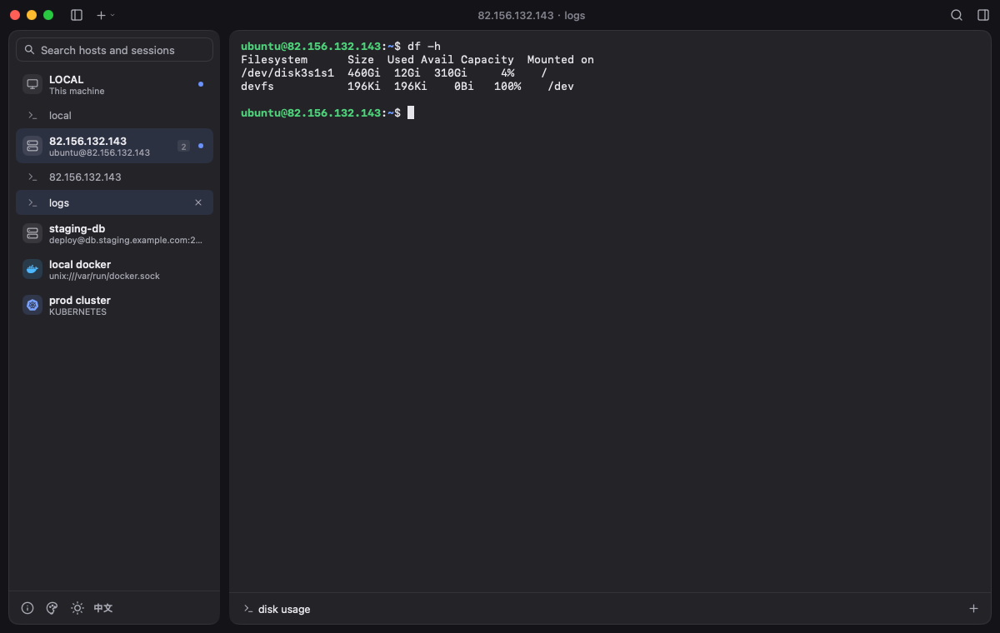

### New session
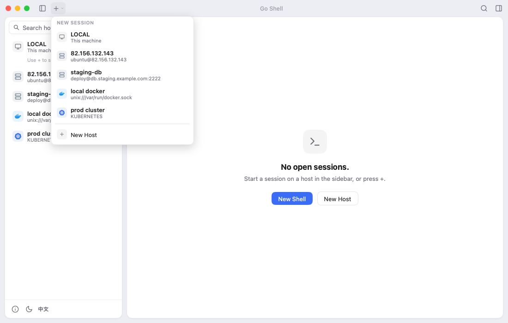

### New command
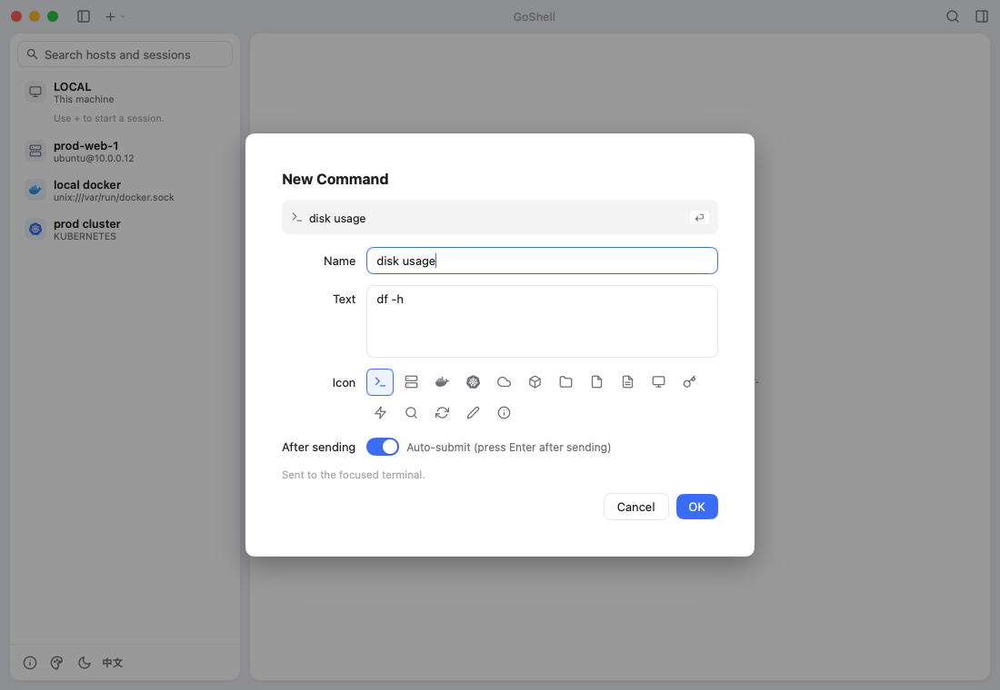

### Program status
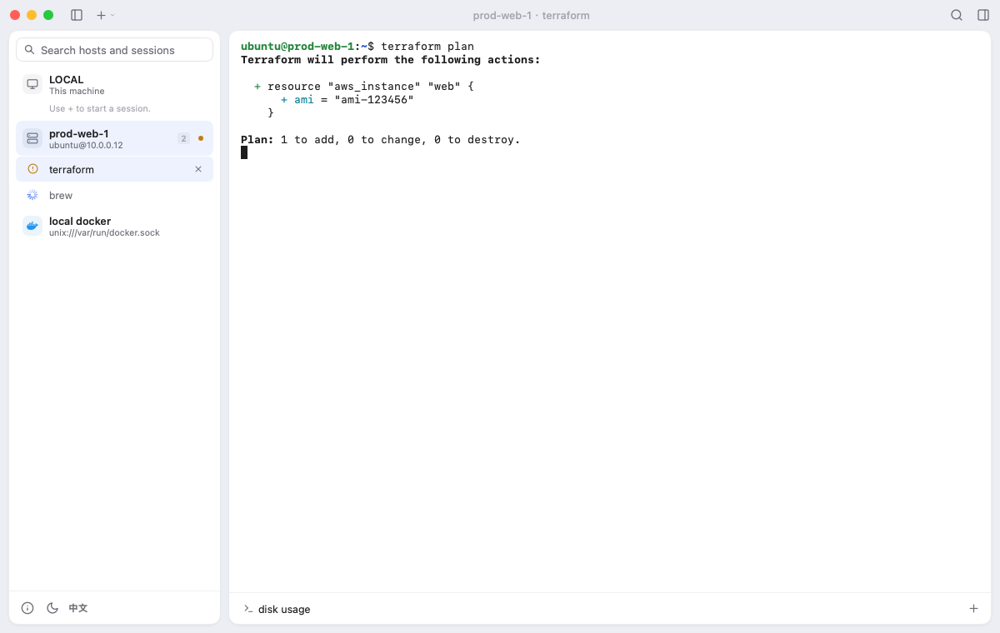

### Find
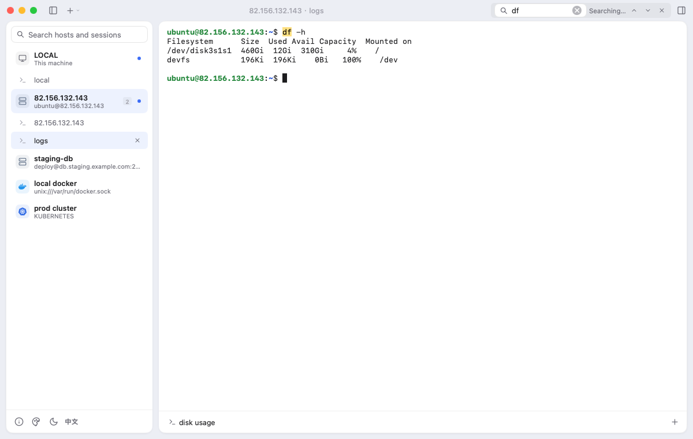

### File sidebar
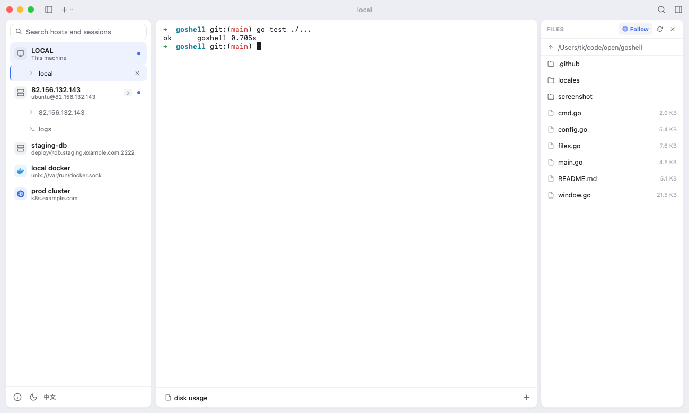

### SSH host
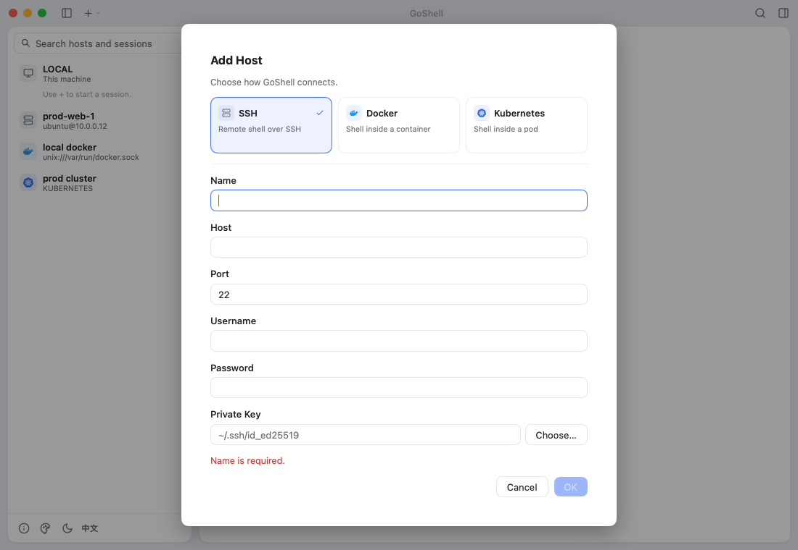

### Docker host
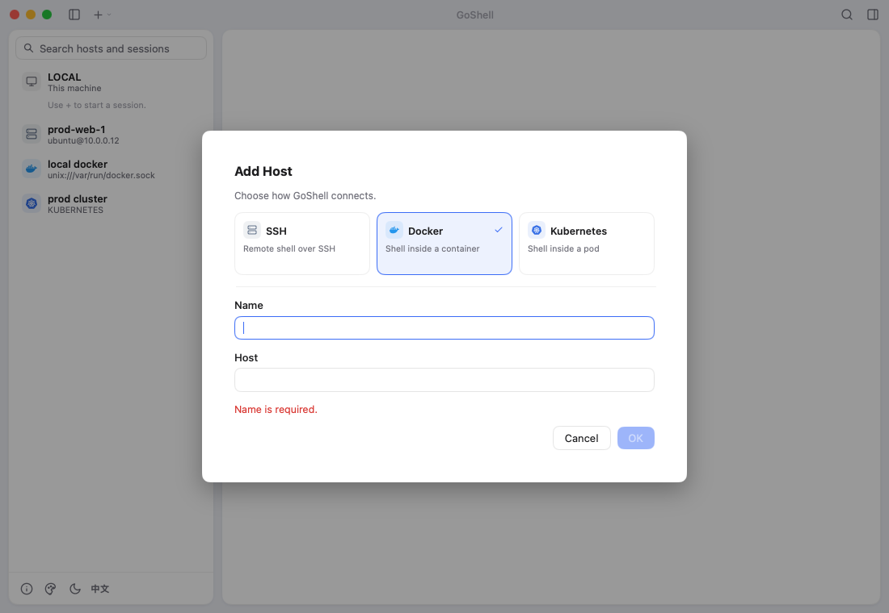

### Docker container
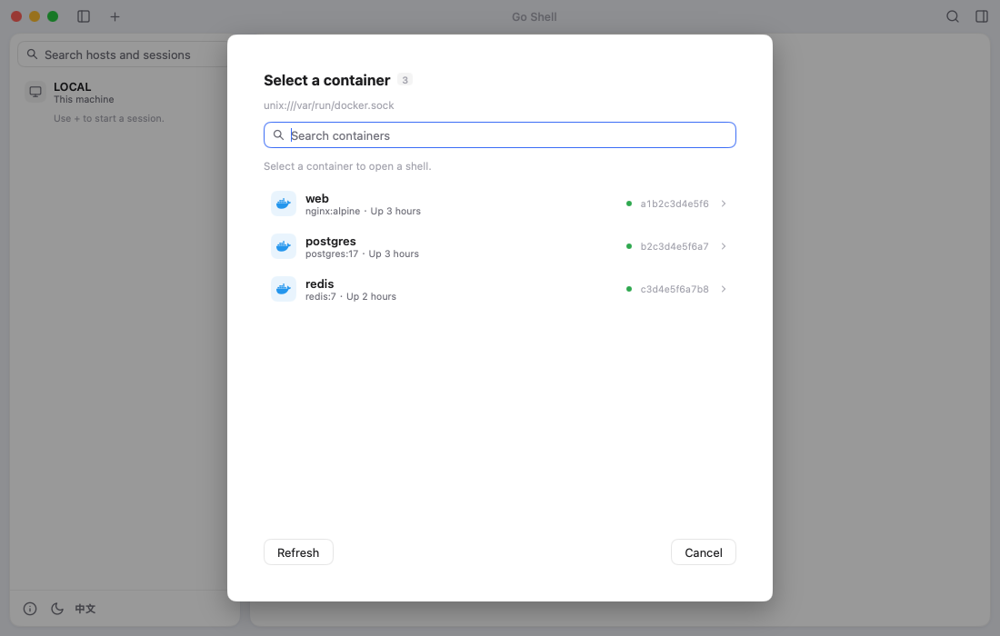

### Kubernetes host
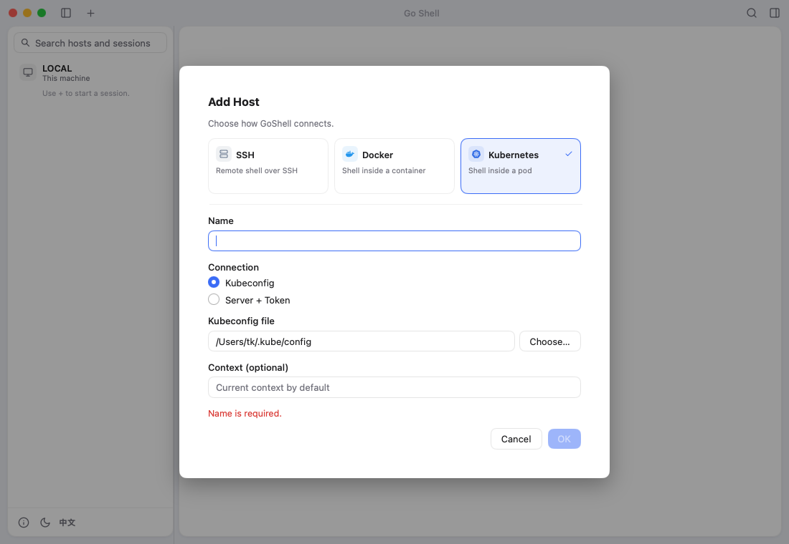

### Kubernetes container
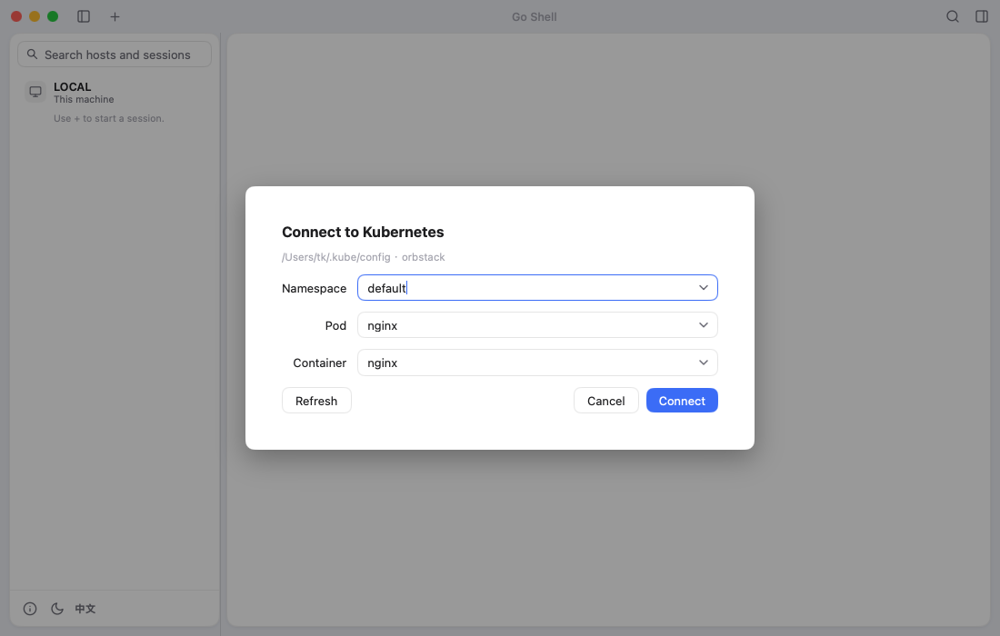

# Hosts and sessions

The left sidebar keeps hosts, not terminals: `LOCAL` and the saved SSH
servers, Docker daemons and Kubernetes clusters, flattened in one list and
told apart by their icons and colors. The sessions open on a host are its
children in the sidebar. Click a host to fold or unfold them; the `+` shown
on hover starts a new session on that host.

The `+` beside the sidebar button opens the new-session popover: `LOCAL`
first, then each host with its address and open-session count, and a New Host
action at the end. With no saved hosts, it starts `LOCAL` directly. There are
no tabs above the terminal: the title bar names the session on top, and its
host is lit in the sidebar.

SSH connects to the host. Docker and Kubernetes open a picker first:

- Docker lists running containers with a search field, image, status and
  state; click a container to open a shell.
- Kubernetes selects the `default` namespace and the first pod and container,
  with searchable fields for changing them.

Adding a host starts with cards for SSH, Docker and Kubernetes, then asks only
for that kind's fields.

# Shortcut commands

File > New Command adds a command to the bar under the terminal. The dialog
shows a live preview of the command chip and offers sixteen icons. A command
has a name, the text to send and an Auto-submit switch.

Clicking a chip sends it to the focused terminal. Hovering a chip shows a red
delete badge at its top-right corner; right-clicking it opens edit and delete.

# File sidebar

The right sidebar lists the selected terminal's folder. It reads this
machine's disk, an SSH server over SFTP, a Docker container and a Kubernetes
pod through commands in the container. Click a folder to enter it, use the
arrow to go up, or refresh to list it again; drag the edge to resize the
sidebar, and double-click the edge to reset it.

"Follow" keeps the sidebar on the shell's current directory. It uses the
directory a shell reports with OSC 7 when it does; for Docker, Kubernetes and
SSH on Linux it reads the interactive shell's `/proc` entry instead, so it
follows `cd` without shell configuration. With Follow off, the sidebar stays
where you left it. The choice is kept for the next launches. A zsh without a
directory reporter can add one:

```sh
precmd() { printf '\e]7;file://%s%s\e\\' "$HOST" "$PWD" }
```

# Program status

GoShell speaks the [Program Status Protocol](https://www.superlogical.com/rex/docs/build/program-status)
(OSC 7501). A program reports whether it is `idle`, `working`, `done`,
`blocked` or `error`, and may add an `app`, a base64 `title` and `msg`, a
`progress` percentage, and a `kind` (`permission`, `question` or `auth`)
when it is blocked. Reports with an `id` keep several records at once, with
`clear` removing one and the records beneath it.

The session row shows a spinner, an alert, a check or a cross, and its host
wears the most important state among its sessions. Hover the status icon for
the program, its message and its progress. Typing in a terminal dismisses its
`done` and `error` records; a new shell prompt drops `working` and `blocked`
ones. Feature detection (`OSC 7501;?`) is answered.

A shell function that reports around a command:

```sh
status() {
  printf '\e]7501;state=%s:msg=%s\e\\' "$1" "$(printf '%s' "$2" | base64 | tr -d '\n')"
}

status working "Syncing photos"
rsync -a ~/Photos backup:/photos && status done "Photos synced" || status error "rsync failed"
```

# Appearance and language

The foot of the host sidebar has a moon or sun button that switches between
the light and the dark appearance, a `中文`/`EN` button that switches the
language, and About. The title bar holds Find, the file sidebar toggle and,
when there is one, an update reminder; New Command is in the File menu. The View menu has the same choices, with
"System" to follow the desktop's appearance and languages.

View > Terminal Theme… chooses one of the themes Ghostty ships, or returns
the terminals to the card's own colors. Every choice is kept for the next
launches.

# Local Docker

At launch GoShell checks `DOCKER_HOST`, or the client's default socket or
pipe, for a running Docker daemon. When one answers and no config for it is
saved, it adds a "Local Docker" host once. Deleting that host keeps it
deleted.

# Updates

Packaged builds check the [latest GitHub release](https://github.com/tk103331/goshell/releases)
for updates in the background, and Help > Check for Updates… asks right away.
The native update window shows the version and notes, then downloads, verifies
and installs the signed update and offers to relaunch. Help > About shows the
running version; when a check finds a newer one, a download chip appears in
the title bar as well.

The update files are signed with the Ed25519 key whose public half is in
`mygo.json` (`updates.publicKey`). `mygo build` reads the private half from
`MYGO_UPDATER_PRIVATE_KEY`; the release workflow takes it from the repository
secret of the same name:

```sh
gh secret set MYGO_UPDATER_PRIVATE_KEY < ~/Library/Application\ Support/mygo/update-keys/mygo-update.key
```

Without the secret, releases still build but carry no update manifests, so
installed apps stay on their version. Development builds and apps installed
by a package manager cannot update themselves.

# Building

MyGo needs Go 1.27.3+. The terminal is emulated with Ghostty's
libghostty-vt, which `go run` downloads once into the user's cache.

- Linux / macOS

``` shell
    git clone https://github.com/tk103331/goshell.git
    cd goshell
    go build
    sudo ./goshell
```

- Windows (run as administrator)

``` shell
    git clone https://github.com/tk103331/goshell.git
    cd goshell
    go build
    goshell
```

# Languages

The app speaks English and Simplified Chinese (`locales/en.json`,
`locales/zh-Hans.json`, said by the generated `locales/catalog_gen.go`).
The language button at the foot of the host sidebar and View > Language
switch between them; "System" follows the user's languages, and the choice
is kept for the next launches.

# Releasing

Commit, tag the version of `mygo.json`, and push the tag: the
[release workflow](.github/workflows/release.yml) builds the macOS disk
images, Windows installers and Linux packages, uploads them to a draft
release, and publishes it.

``` shell
    jq -r .version mygo.json          # 0.1.0
    git tag v0.1.0
    git push origin v0.1.0
```
