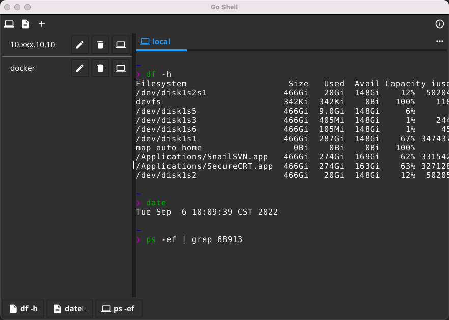
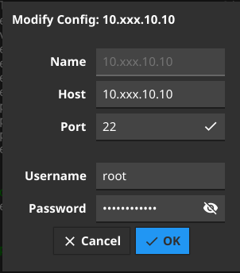
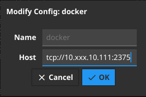
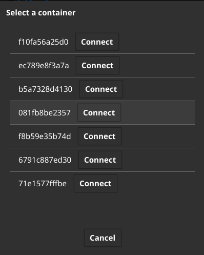
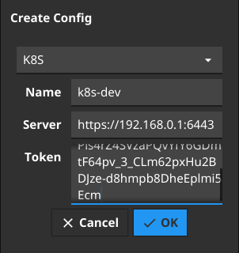
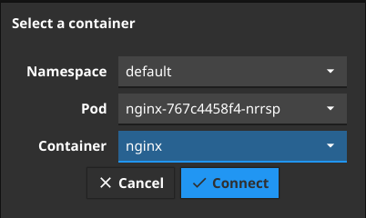

# GoShell(WIP)

GoShell is a simple terminal GUI client, written in Go,via [MyGo](https://github.com/egoist/mygo). Supports SSH、Docker、K8S.


# Features

- Supports SSH、Docker、K8S.
- Supports Windows、Linux、MacOS platform.（thanks [MyGo](https://github.com/egoist/mygo)）
- Supports shortcut command.

# Screenshots
### Main

### SSH Config

### Docker Config

### Docker Select Container

### K8S Config

### K8S Select Container


### Building

MyGo needs Go 1.27.3+. The terminal is emulated with Ghostty's libghostty-vt, which `go run` downloads once into the user's cache.

- Linux / MACOS
``` shell
    git clone https://github.com/tk103331/goshell.git
    cd goshell
    go build
    sudo ./goshell
```
- Windows (Need to run with administrator rights)
``` shell
    git clone https://github.com/tk103331/goshell.git
    cd goshell
    go build
    goshell
```

# TODOs

- UI/UX optimization
- Configuration encryption 

# Languages

The app speaks English and Simplified Chinese (`locales/en.json`,
`locales/zh-Hans.json`, said by the generated `locales/catalog_gen.go`).
View > Language switches between them; "System" follows the user's
languages, and the choice is kept for the next launches.

# Releasing

Commit, tag the version of `mygo.json`, and push the tag: the
[release workflow](.github/workflows/release.yml) builds the macOS disk
images, Windows installers and Linux packages, uploads them to a draft
release, and publishes it.

``` shell
    jq -r .version mygo.json          # 0.1.0
    git tag v0.1.0
    git push origin v0.1.0
```
