# GoShell

[English](README.md) | **简体中文**

GoShell 是一个简单的终端图形客户端，使用 Go 编写，基于
[MyGo](https://github.com/egoist/mygo)。它在一个原生窗口中管理 SSH、
Docker 和 Kubernetes 主机，在主机下打开终端会话，并把这些主机保存在
侧栏中。

# 功能

- 支持 SSH、Docker、Kubernetes 主机。Kubernetes 支持 kubeconfig +
  Context，也支持服务器 + Token。
- 一个主机可以打开多个会话，会话作为子项显示在主机下面。
- `LOCAL` 与所有主机平铺显示，通过图标和颜色区分 SSH、Docker 和
  Kubernetes。点击主机展开 / 折叠会话，悬停时的 `+` 可在该主机上新建会话。
- 左侧边栏支持搜索主机和会话。
- 右侧文件边栏支持本地、SSH、Docker 和 Kubernetes 会话，并可按终端当前
  目录自动跟随。
- Docker 容器选择支持搜索、镜像、状态展示和点击连接。
- Kubernetes 选择框支持搜索命名空间、Pod、容器，并自动选择默认项。
- 快捷命令以 Chip 显示在终端下方，支持实时预览、图标选择和悬停删除角标。
- 支持六种颜色主题并提供效果预览，浅色 / 深色外观默认跟随系统。
- 支持 Ghostty 终端主题。
- 支持英文和简体中文。
- 支持 Windows、Linux、macOS，感谢 [MyGo](https://github.com/egoist/mygo)。
- 保存的密码、私钥口令和 Token 会加密存储。
- 首次启动时检测本地 Docker daemon，并自动添加配置。
- 支持 Program Status Protocol（OSC 7501）：会话行图标显示程序状态，
  悬停可查看消息。
- 标题栏支持查找；检测到新版本时，标题栏显示下载提醒。
- 支持从 GitHub Release 签名自动更新，并提供 Help > Check for Updates…

# 截图

### 主界面
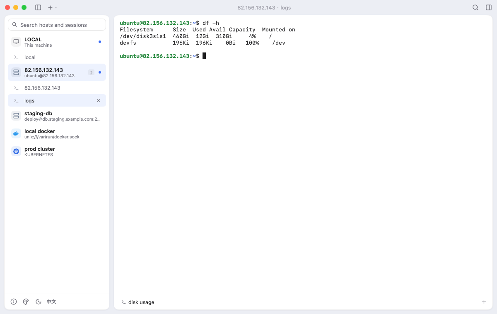

### 深色主题
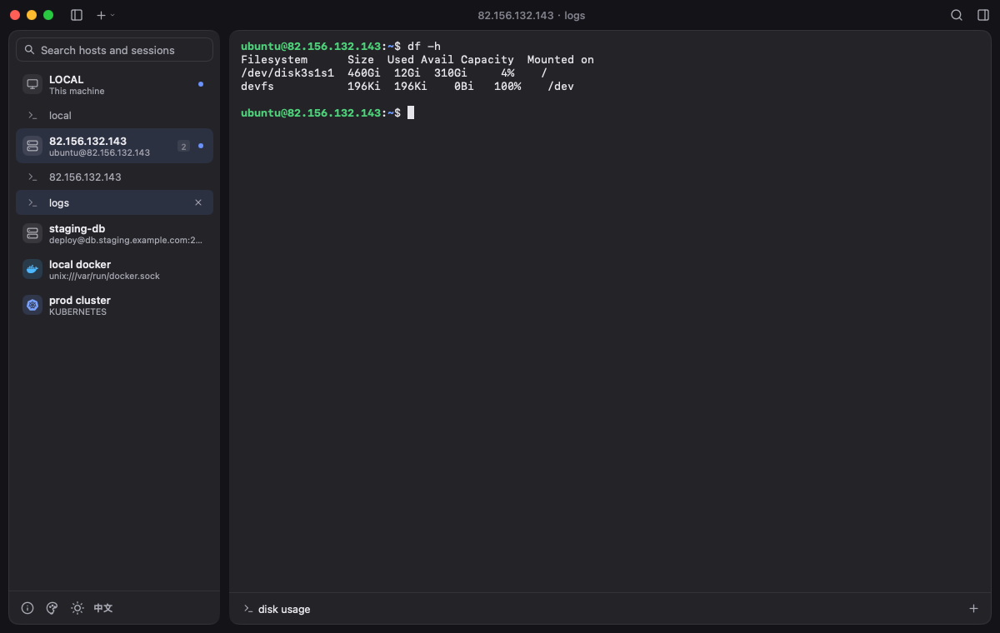

### 颜色主题
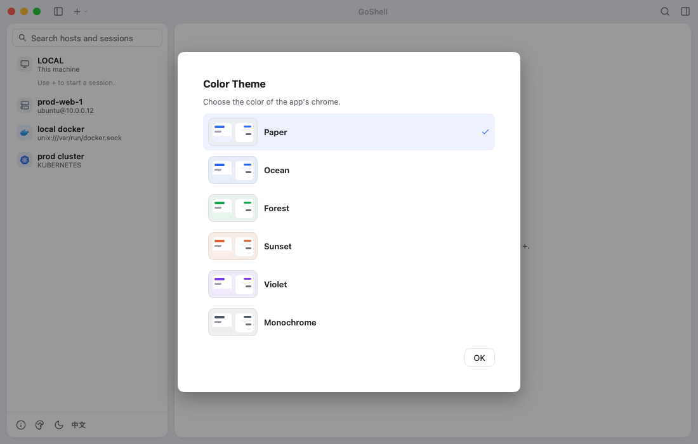

### 新建会话
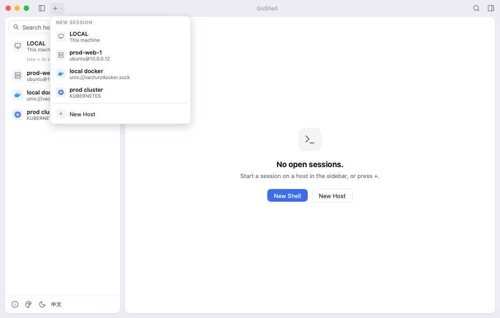

### 新建快捷命令
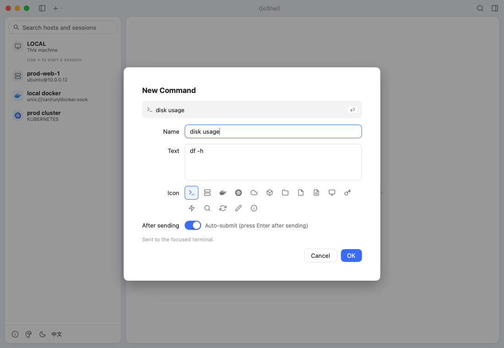

### 程序状态
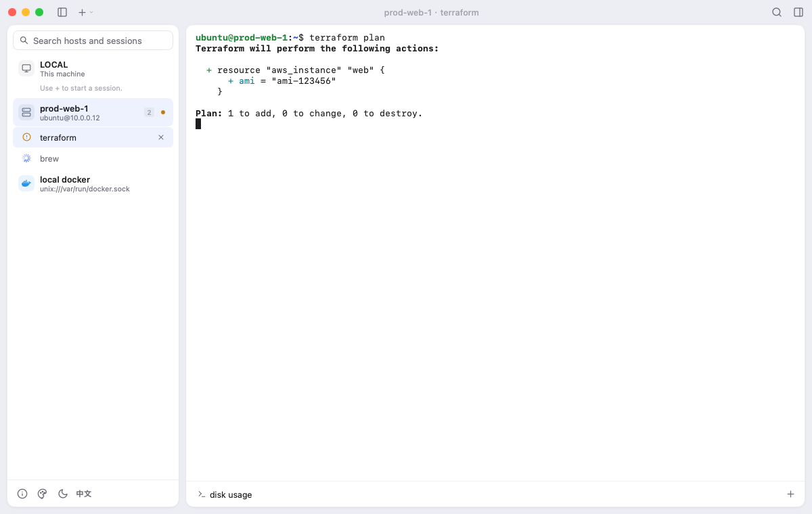

### 查找
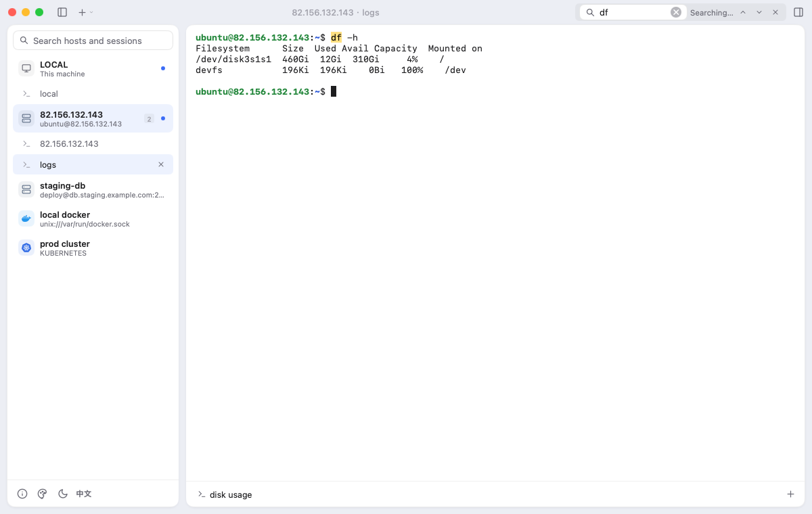

### 文件边栏
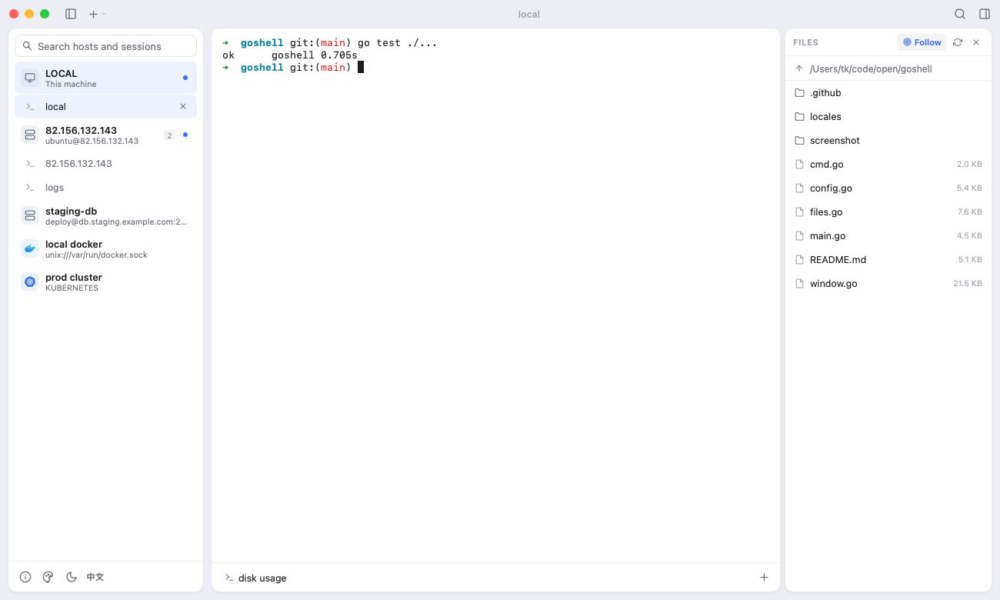

### SSH 主机
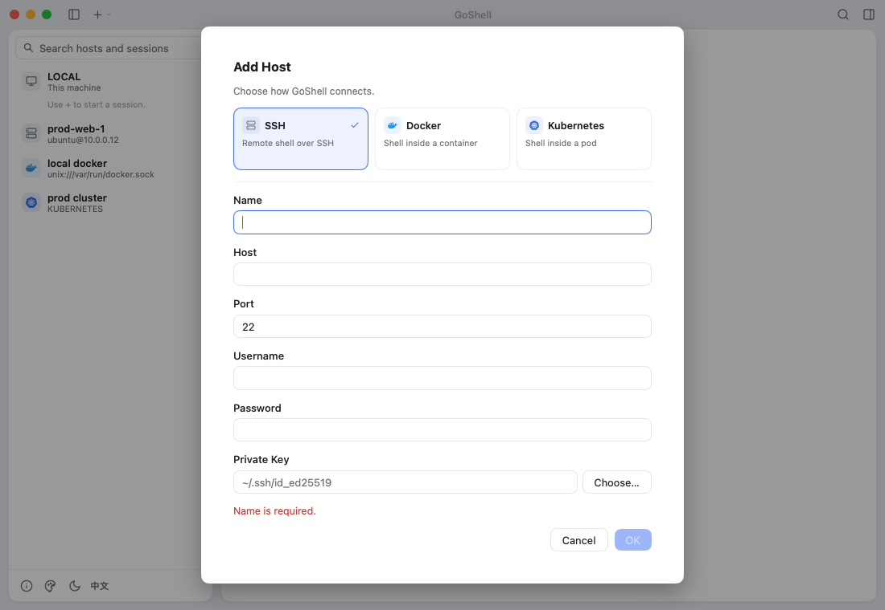

### Docker 主机
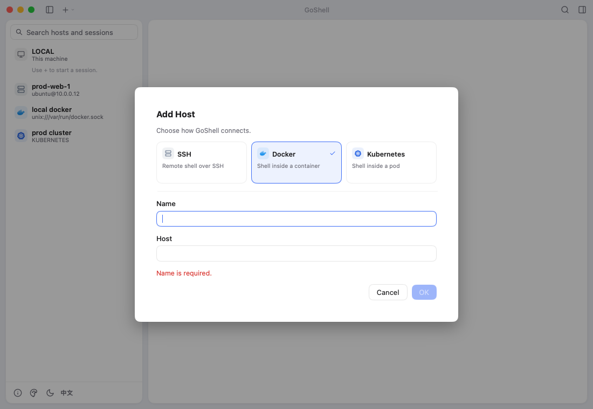

### Docker 容器
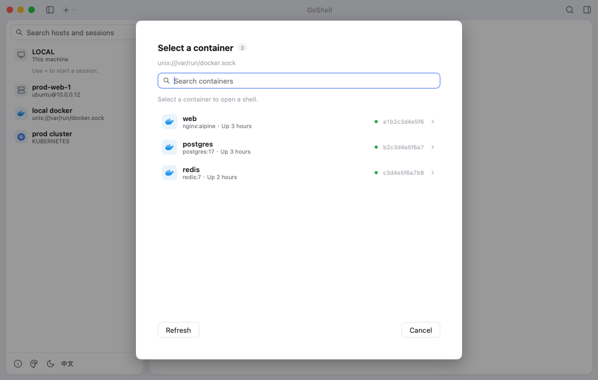

### Kubernetes 主机
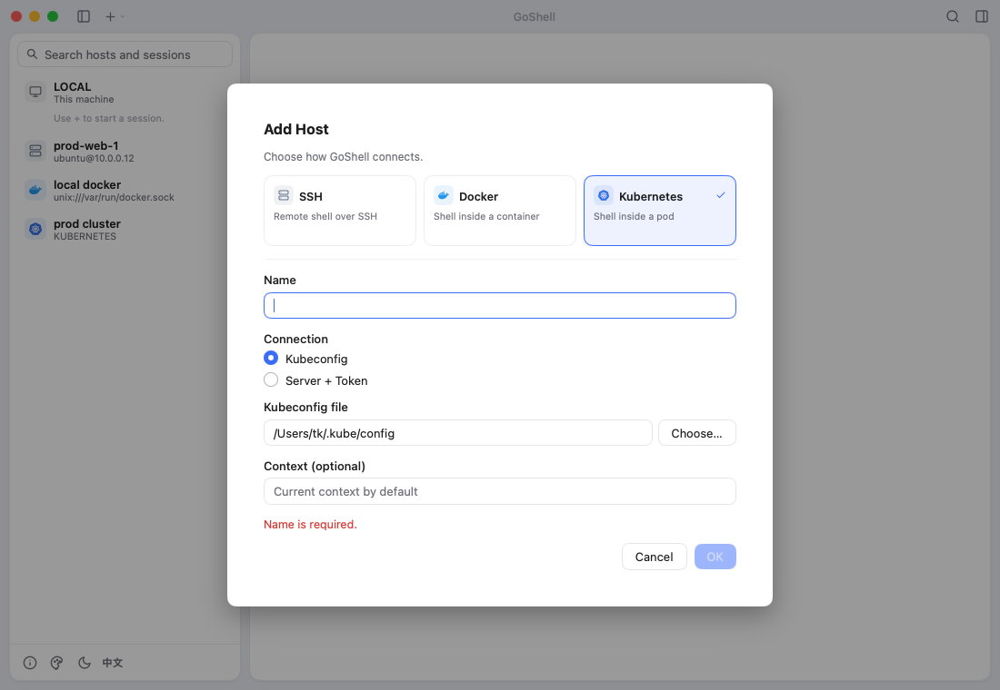

### Kubernetes 容器
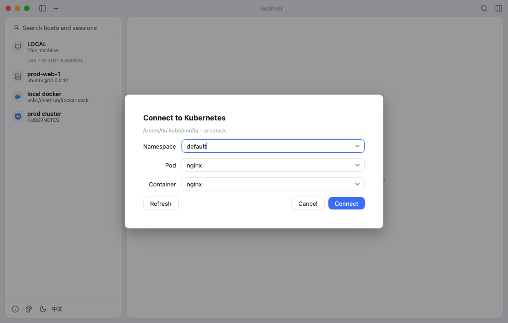

# 主机与会话

左侧边栏保存的是主机，而不是终端：`LOCAL` 以及已保存的 SSH 服务器、
Docker daemon 和 Kubernetes 集群，全部平铺在同一列表中，通过图标和颜色区分。
主机下显示该主机的会话。点击主机可展开 / 折叠会话；悬停时显示的 `+`
用于在该主机上新建会话。

侧栏切换按钮旁边的 `+` 会打开新建会话弹层：第一项固定为 `LOCAL`，
后面是各主机及其地址、已打开会话数量，最后是「新建主机」。
没有任何已保存主机时，点击 `+` 直接创建 `LOCAL` 会话。终端上方没有标签页：
标题栏显示当前会话名称，对应主机在左侧高亮。

SSH 主机直接建立连接。Docker 和 Kubernetes 会先打开选择框：

- Docker：显示运行中的容器，可搜索，包含镜像、状态和状态点；点击容器即可连接。
- Kubernetes：默认选择 `default` 命名空间、第一个 Pod 和第一个容器，
  字段均可搜索和修改。

新建主机时先选择 SSH、Docker 或 Kubernetes 卡片，然后只显示对应类型需要的字段。

# 快捷命令

通过 File > New Command 在终端下方添加快捷命令。弹窗提供命令 Chip 的实时预览
和 16 个图标选择；命令包含名称、发送文本和「发送后自动回车」开关。

点击命令 Chip 会发送到当前终端。鼠标移入 Chip 时，右上角显示红色删除角标；
右键可编辑或删除。

# 文件边栏

右侧边栏显示当前终端所在目录。它支持本机磁盘、SSH 服务器（SFTP）、
Docker 容器和 Kubernetes Pod 中的目录。点击文件夹进入，使用向上箭头返回，
或点击刷新重新读取；拖动边缘可调整宽度，双击边缘恢复默认宽度。

“Follow” 会让文件边栏跟随 shell 当前目录。shell 上报 OSC 7 时直接使用该目录；
在 Linux 上的 Docker、Kubernetes 和 SSH 中，会读取交互 shell 的 `/proc`
信息，因此无需 shell 配置也能跟随 `cd`。关闭 Follow 后，边栏停留在手动浏览的位置。
该选择会保存到下次启动。如果 zsh 没有上报目录，可以添加：

```sh
precmd() { printf '\e]7;file://%s%s\e\\' "$HOST" "$PWD" }
```

# 程序状态

GoShell 支持 [Program Status Protocol](https://www.superlogical.com/rex/docs/build/program-status)
（OSC 7501）。程序可以上报 `idle`、`working`、`done`、`blocked`、`error`
状态，并可附带 `app`、base64 编码的 `title` 和 `msg`、`progress` 百分比，
以及 `blocked` 时的 `kind`（`permission`、`question`、`auth`）。
带 `id` 的上报可以同时维护多条记录，`clear` 会删除指定记录及其子记录。

会话行显示 spinner、警示、勾选或叉号；主机显示其会话中最重要的状态。
悬停状态图标可查看程序、消息和进度。在终端中输入会清除 `done` 和 `error`
记录；新的 shell 提示符会清除 `working` 和 `blocked` 记录。
支持特性探测（`OSC 7501;?`）。

一个用于上报命令状态的 shell 函数示例：

```sh
status() {
  printf '\e]7501;state=%s:msg=%s\e\\' "$1" "$(printf '%s' "$2" | base64 | tr -d '\n')"
}

status working "Syncing photos"
rsync -a ~/Photos backup:/photos && status done "Photos synced" || status error "rsync failed"
```

# 外观与语言

主机侧栏底部有调色板按钮，用于打开带效果预览的颜色主题选择框；还有月亮 /
太阳按钮切换浅色和深色主题，`中文`/`EN` 按钮切换语言，以及关于按钮。标题栏包含查找、文件边栏按钮，以及可用更新提醒；
新建快捷命令位于 File 菜单中。View 菜单提供相同的主题、语言和终端主题选项，
“System” 表示跟随系统外观和语言。

View > Terminal Theme… 可以选择 Ghostty 内置的终端主题，或恢复为卡片默认配色。
所有选择都会保存到下次启动。

# 本地 Docker

启动时 GoShell 会检查 `DOCKER_HOST`，或 Docker 客户端默认的 socket / pipe。
如果本地 Docker daemon 有响应，且还没有对应配置，会自动添加一个
“本地 Docker” 主机，只添加一次。用户删除后不会再次自动添加。

# 版本更新

打包后的应用会在后台检查 [GitHub 最新 Release](https://github.com/tk103331/goshell/releases)，
也可以从 Help > Check for Updates… 立即检查。原生更新窗口会显示版本和更新说明，
下载并校验签名后安装，并询问是否重启进入新版本。Help > About 显示当前版本；
检查到新版本时，标题栏也会显示下载提醒。

更新文件使用 Ed25519 私钥签名，公钥保存在 `mygo.json` 的 `updates.publicKey`。
`mygo build` 从 `MYGO_UPDATER_PRIVATE_KEY` 读取私钥；发布工作流从同名
Repository Secret 读取：

```sh
gh secret set MYGO_UPDATER_PRIVATE_KEY < ~/Library/Application\ Support/mygo/update-keys/mygo-update.key
```

没有配置 Secret 时，Release 仍会构建，但不会包含更新清单，已安装的应用不会自动更新。
开发构建和通过包管理器安装的应用不支持自更新。

# 构建

MyGo 需要 Go 1.27.3+。终端由 Ghostty 的 libghostty-vt 模拟，`go run`
首次运行时会下载到用户缓存。

- Linux / macOS

``` shell
    git clone https://github.com/tk103331/goshell.git
    cd goshell
    go build
    sudo ./goshell
```

- Windows（需要以管理员身份运行）

``` shell
    git clone https://github.com/tk103331/goshell.git
    cd goshell
    go build
    goshell
```

# 语言

应用支持英文和简体中文（`locales/en.json`、`locales/zh-Hans.json`，
由生成的 `locales/catalog_gen.go` 提供）。可以通过主机侧栏底部的语言按钮
或 View > Language 切换；“System” 跟随用户语言，选择会保存到下次启动。

# 发布

提交代码、打上 `mygo.json` 中的版本标签并推送：发布工作流会构建 macOS
磁盘镜像、Windows 安装包和 Linux 安装包，上传到草稿 Release，然后发布。

``` shell
    jq -r .version mygo.json          # 0.1.0
    git tag v0.1.0
    git push origin v0.1.0
```
